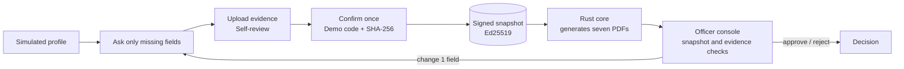

<div align="center">

<picture>
  <source media="(prefers-color-scheme: dark)" srcset="assets/brand/logo-dark.svg">
  
</picture>

### Answer once. Review the evidence. Generate a document package.

A local company-incorporation demo: reuse profile facts, answer three missing questions, review uploaded evidence, and generate all seven official forms as PDFs from one confirmed snapshot. Identity and registry sources are simulated; official forms are partially populated.

[English judge guide](docs/JUDGE-GUIDE.md) · [Demo video](demo/zero-form-demo.webm) · [Quick start](#quick-start) · [Chrome extension](#chrome-extension) · [Engine reference](docs/ENGINE.md) · [Pixel verification](docs/VERIFICATION.md) · [Semantic test results](bench/review/haiku-live-results/README.md) · [Mismatch checks](docs/SEMANTIC-VERIFICATION.md)

</div>

---

## Why

- **Forms repeat the same facts.** The selected demo has seven form definitions and asks three new questions, reusing the remaining seeded facts.
- **Applicants confirm once, not seven times.** One text-code confirmation is bound to the SHA-256 of an immutable snapshot and sealed with an Ed25519 server signature.
- **Reviewers compare evidence with confirmed facts.** The console checks snapshot integrity, generated files and uploaded evidence. Identity and registry comparisons use simulated sources; a requested correction reopens one field.

## How it works

1. **Zero refill.** Seeded facts marked verified in the simulated profile (name, national ID, phone, address, company name, business items) are shown with their source and confirmed with one click.
2. **Ask once.** Only missing fields are asked, one question per screen. Each shows "used in N of 7 forms". National IDs are checksum-validated.
3. **Self-review before signing.** Upload the three evidence PDFs. Source-grounded extraction feeds deterministic company, capital and date checks; an optional LLM explanation describes the result. All three external PDFs and a passing current review are mandatory before signing; missing or uncertain evidence blocks it.
4. **Confirm once.** The applicant reviews, then enters the demonstration code displayed on screen. The code is bound to the snapshot hash; the server seals `{hash, confirmation}` with Ed25519.
5. **Generate every document.** The native Rust core generates seven PDFs, one per fillable official form on the Taipei registration page (Step 1 name reservation c00001 and the Step 4 forms), using the unmodified GCIS originals as backgrounds. The current mapping has 42 occurrences: 26 populate original blanks, including the shared name reservation number on the application and registration form; 16 (mostly ROC dates split across 年/月/日 and repeated role names) appear in labeled appendices. The package records the snapshot and PDF hashes.
6. **Officer review.** The console at `/officer.html` displays snapshot and evidence checks, then the local reviewer approves, rejects, or requests a change to one field. The re-signed snapshot v2 links to v1 through `prev`.



AI agents can draft answers through `GET /api/agent/schema` and `POST /api/agent/draft`. Only the human can confirm and sign. See [Agent API and self-review setup](docs/AGENT_API.md) for endpoints and opt-in Haiku configuration; missing credentials never produce a simulated LLM success.

## Demo

[`demo/zero-form-all-forms.webm`](demo/zero-form-all-forms.webm) is the current all-forms run: agency setup over all 7 official forms (Claude reads them in parallel; 36 fields → 11 facts → 3 to type), the applicant flow, and a contact sheet of every generated official PDF (`ZF_APP=http://localhost:<port> npm run record` if 5173 is taken).

[`demo/zero-form-demo.webm`](demo/zero-form-demo.webm) is an earlier narrated demonstration. The current flow requires all three uploads and self-review before signing; the recorder script has been updated, but this video has not been regenerated for that change:

1. The real [Taipei City incorporation page](https://tcooc-co.gov.taipei/cp.aspx?n=1ddc8c221b97a1bd&s=5BA095ECA5D6FAB3) with the extension's **Fill all 7 forms with Zero Form** launcher, opening the side drawer.
2. Sign-in with a text code, known facts prefilled, three missing questions, and the single confirmation that seals 6 generated documents.
3. The officer console: five green checks, a facts table with sources, and a request to change one field.
4. The applicant fixing only that field and re-signing (snapshot v2), followed by approval.
5. Altering stored data after signing, which turns the Identity, Integrity and Consistency checks red.

## Quick start

Requirements: Node.js and npm.

```sh
npm install
npm run dev
```

- Applicant panel: http://localhost:5173
- Officer console: http://localhost:5173/officer.html

Normal mode requires the applicant to upload the capital report, address precheck and name reservation PDFs. These external documents are separate from the seven forms generated from the confirmed facts. Open `http://localhost:5173/?demo=1` and select **Load demo PDFs** to attach marked samples for the missing document types. Select **Preview PDF** next to any attachment to open it.

`PORT` and `DATA_DIR` override the port and the state directory.

**Native PDF generation** (run on signing) additionally needs the engine toolchain. The server calls `scripts/render-application.py`, which uses ReportLab and the built `target/debug/zero-form` binary:

| Tool | Version |
| --- | --- |
| Rust | 1.97.1 (selected by `rust-toolchain.toml`) |
| [Typst](https://github.com/typst/typst/releases/tag/v0.15.1) | 0.15.1 |
| Poppler (`pdftoppm`, `pdftotext`) | 26.05.0 tested |
| Python 3 + ReportLab + pypdf + fonttools | `python3 -m pip install reportlab 'pypdf<7' fonttools` |

```sh
cargo build --workspace --locked
```

Put Typst and Poppler on `PATH`, in the ignored `.tools/bin/`, or point `ZERO_FORM_TYPST`, `ZERO_FORM_PDFTOPPM` and `ZERO_FORM_PDFTOTEXT` at them. Signing can take around a minute while the PDFs are generated; use a fresh `DATA_DIR` for a clean demo.

## Chrome extension

1. Start the app with `npm run dev`.
2. Open `chrome://extensions`, turn on **Developer mode**, click **Load unpacked**, and select `extension/`.
3. Open the [Taipei incorporation page](https://tcooc-co.gov.taipei/cp.aspx?n=1ddc8c221b97a1bd&s=5BA095ECA5D6FAB3) and click **Fill all 7 forms with Zero Form**.
4. When Chrome asks to access apps on your local network, click **Allow**. Chrome 142+ otherwise blocks a public HTTPS page from framing `localhost`.

Offline: open `extension/test-page.html` directly; it loads `content.js` itself.

## Checks and recording

```sh
npm run check    # starts a throwaway server and prints PASS/FAIL per feature (GOAL.md criteria 2–10)
npm run record   # with `npm run dev` running: records demo/zero-form-demo.webm via Playwright
node demo/integration.mjs   # native happy path: real PDFs, evidence upload, reviewer approval
```

`npm run record` needs Playwright's Chromium (`npx playwright install chromium`). Engine tests are in [docs/ENGINE.md](docs/ENGINE.md#verification-and-remaining-work).

## Architecture

| Path | What it is |
| --- | --- |
| `public/` | Applicant panel (`index.html`, `app.js`) and officer console (`officer.html`, `officer.js`); shared form schema in `schema.js` |
| `server.js` | Node/Express adapter: login and signing codes, snapshots, Ed25519 seal, document generation, officer checks and decisions, agent API |
| `crates/zero-form-core` | Rust engine: definitions, fact resolution, snapshots, semantic mapping, PDF composition, verification, packaging |
| `crates/zero-form-cli` | `zero-form` CLI over the core (`prepare`, `render`, `verify`, `publish`, `run`, `doctor`, `schema`) |
| `scripts/` | `check.mjs` feature check, `demo.sh` engine demo, PDF render and fixture scripts, `tools.sh` tool lookup |
| `demo/` | `record.mjs` video recorder and an earlier standalone evidence-review demo ([demo/README.md](demo/README.md)) |
| `extension/` | Chrome extension that injects the panel into the Taipei page |
| `bench/` | Engine fixtures (`bench/demo/`) and synthetic evidence PDFs (`bench/review/`) |
| `assets/` | Official templates, fonts (TW-Kai and legacy fonts, SIL OFL 1.1), source hashes and licensing |
| `design/zero-form.pen` | UI design file |
| `GOAL.md` | Demo definition of done and API contract |

Full engine documentation (CLI, input contracts, prepare/render/verify/publish, package layout, limits): **[docs/ENGINE.md](docs/ENGINE.md)**.

## What's real and what's mocked

| Real | Mocked or simulated |
| --- | --- |
| SHA-256 snapshot hashing over canonical JSON | SMS delivery: the code is shown in an on-screen preview |
| Ed25519 server signature over hash and confirmation | Household registration and name-reservation lookups |
| Native PDF generation by the Rust core, with per-document hashes | Evidence documents (synthetic PDFs, parsed from uploaded bytes) |
| Live tamper detection, revision chain (`prev` hash) | Government submission: there is none |

All data is fictional. The official forms are only partially populated, so the output is **not a filing-ready government application**.

## Team and license

Built by Friday Shipping Club for a hackathon. No license file has been added yet.
