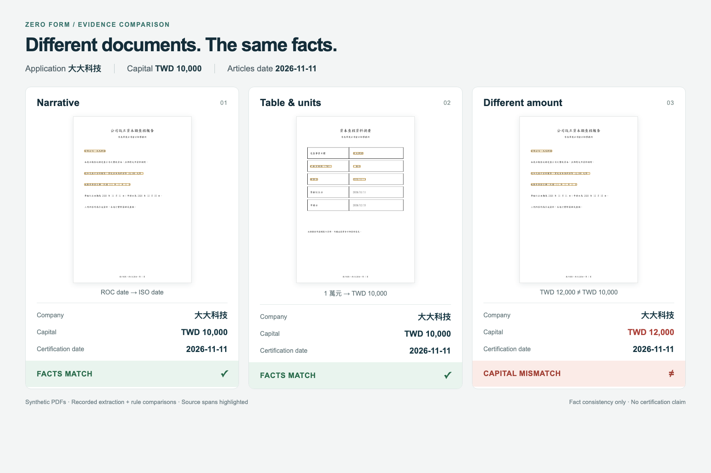

# Haiku test results — 2026-11-11

Five authorized live calls to `claude-haiku-5-5`, zero retries: four forced
extractions and one explanation. Usage: 6,170 input / 1,731 output tokens.

| Test | Observed result |
| --- | --- |
| prose-roc.pdf | Company and certification date extracted; TWD 10,000 matches |
| table-units.pdf | Table amount normalized to TWD 10,000; company/date match |
| two-page-letter.pdf | Evidence correctly located on page 2; TWD 10,000 matches |
| prose-mismatch.pdf | TWD 12,000 retained; deterministic comparison flags mismatch |
| Explanation | Described the mismatch without changing the rule result |
| Offline browser flow | 3 uploads → 12 checks → unknown PDF blocks signing → restored evidence → simulated OTP → 6 verified PDFs → local reviewer approval; no browser errors |

These are **four synthetic, text-bearing examples**, not real-firm validation or
an accuracy benchmark. Poppler supplies text and coordinates; the LLM selects
existing spans. This is not image vision or OCR. Original-file hashes stayed
unchanged, proving read-only extraction, not optical preservation or authenticity.
Native protected-pixel checks are separate. Identity/OTP are simulated; there is
no government submission connection.

The JSON files retain the measured results and source quotes. `explanation.json`
labels its English translation and retains the original response. Source fixtures
are in `../accountant-variants/`; reproduction commands are in
[Agent API](../../../docs/AGENT_API.md). Provider response IDs and credentials are
omitted, and the temporary key was deleted. Live calls remain off by default.
