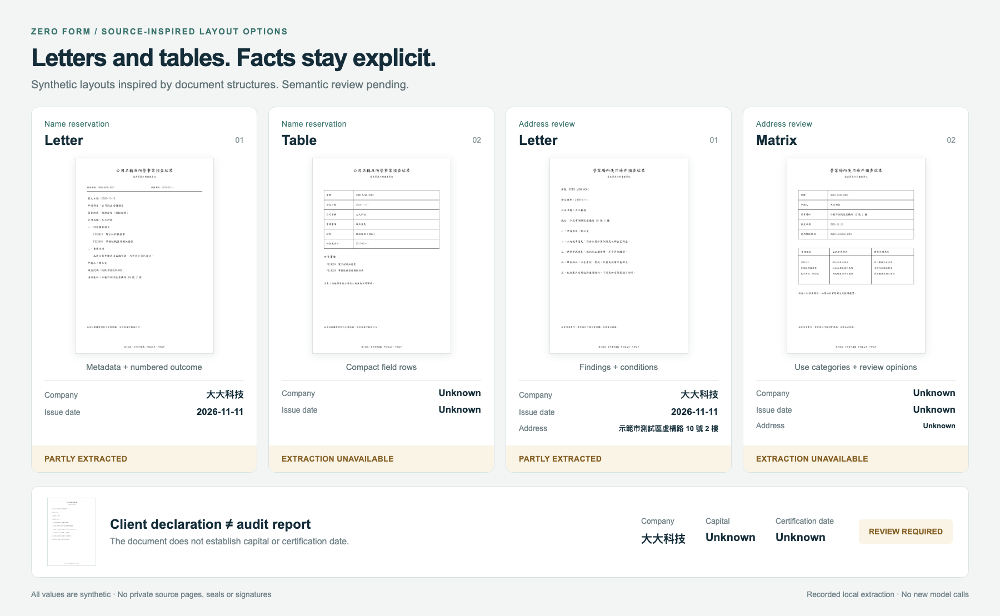

# Source-inspired synthetic document studies

These five generated PDFs borrow only general section order and table/letter structure from a privately reviewed incorporation packet. Every company/person/address/case/permit identifier in these generated studies is synthetic. Private source names, URLs, identifiers, originals, seals and signatures are not included in this repository or sent to a model provider.

| Study | What it demonstrates | Important boundary |
| --- | --- | --- |
| name-letter / name-table | Reservation metadata, company name, business list, expiry, outcome | Name reservation is not company incorporation approval. |
| address-letter / address-table | Premises identification, planning/building findings, use/floor restrictions | Conditional premises findings are not unconditional approval for every activity. |
| client-declaration-not-audit | Addressee, client assertions, unchecked options, blank signoff | A client declaration is not an issued accountant audit report; capital and certification date remain unknown. |

An issued accountant audit report was not identified in the bounded reference review. Existing accountant-variants remain independently illustrative; no claim is made that those reports reproduce a private audit report. Their previously live-tested bytes remain unchanged.

The new five studies have **not** undergone live LLM extraction. `offline-comparison.json` records actual local, deterministic extraction separately from synthetic expectations. Unknown outcomes and missing values must remain unknown. For a real live extraction result, use the existing sanitized Haiku report on the earlier accountant variants, not these new layouts.

Rebuild: `python3 scripts/create-reference-inspired-fixtures.py`. Fonts: official open-licensed TW-Kai. All pages have a discreet sample attribution. No government logo, real license, signature or seal is reproduced.
